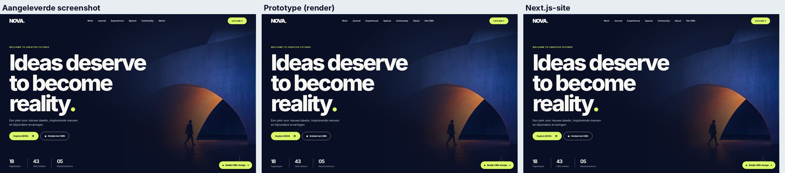
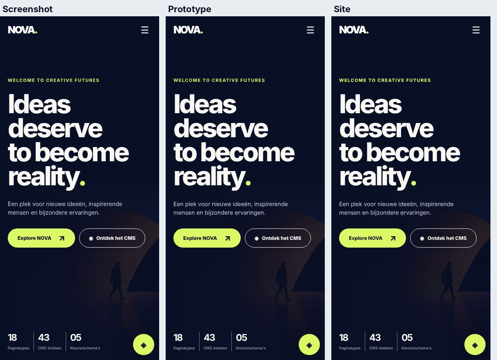

# Visuele controle en kwaliteitsbewijs

## Methode

- **Referenties:** het originele prototype (`referentie/nova-bouwpakket/02_WEBSITE`, lokaal geserveerd)
  en de aangeleverde screenshots (`05_SCREENSHOTS`).
- **Script:** `scripts/visueel-vergelijk.mjs` maakt met Playwright screenshots van prototype en site,
  op 1440×900 en 390×844. Daarnaast controleert het de horizontale overflow op 375, 768 en 1280px.
- **Maat:** het percentage pixels dat duidelijk afwijkt (kanaalverschil > 24, of > 32 tegen de
  aangeleverde PNG's). Het restverschil van ±1% is antialiasing en fontrendering: de screenshots zijn
  gerenderd met systeem-Inter (statische OTF's), de site gebruikt variabele Inter WOFF2.

## Resultaat (eerste viewport en volledige paginahoogte)

| Route                                          | Desktop 1440×900 vs prototype | Desktop vs aangeleverde screenshot | Mobiel 390×844 vs prototype | Paginahoogte desktop (proto → site) | H1  | Horizontale overflow |
| ---------------------------------------------- | ----------------------------- | ---------------------------------- | --------------------------- | ----------------------------------- | --- | -------------------- |
| `/`                                            | 0.8%                          | 1.1%; mobiel 1.7%                  | 1.2%                        | 7954 → 7954                         | 1   | geen                 |
| `/work`                                        | 0.9%                          | 1.6%                               | 1.0%                        | 4251 → 4251                         | 1   | geen                 |
| `/work/aurora-pavilion`                        | 0.7%                          | 1.9%                               | 1.1%                        | 3198 → 3198                         | 1   | geen                 |
| `/journal`                                     | 1.1%                          | 1.8%                               | 1.7%                        | 4395 → 4395                         | 1   | geen                 |
| `/journal/de-kracht-van-immersive-experiences` | 0.8%                          | — (geen screenshot)                | 1.4%                        | 4215 → 4215                         | 1   | geen                 |
| `/experiences`                                 | 1.1%                          | 2.0%                               | 1.3%                        | 4771 → 4771                         | 1   | geen                 |
| `/experiences/nova-sessions`                   | 1.3%                          | — (geen screenshot)                | 1.1%                        | 3408 → 3408                         | 1   | geen                 |
| `/spaces`                                      | 1.0%                          | 1.8%                               | 1.1%                        | 6452 → 4686                         | 1   | geen                 |
| `/spaces/studio-one`                           | 1.5%                          | — (geen screenshot)                | 1.2%                        | 3339 → 3339                         | 1   | geen                 |
| `/community`                                   | 0.7%                          | 2.1%                               | 0.8%                        | 3901 → 3901                         | 1   | geen                 |
| `/about`                                       | 0.8%                          | — (geen screenshot)                | 0.8%                        | 4357 → 4357                         | 1   | geen                 |
| `/contact`                                     | 1.3%                          | 2.0%                               | 2.3%                        | 2564 → 2576                         | 1   | geen                 |
| `/lab`                                         | 1.0%                          | 1.7%                               | 2.4%                        | 3575 → 3575                         | 1   | geen                 |
| `/members`                                     | 0.9%                          | — (geen screenshot)                | 1.6%                        | 2417 → 2446                         | 1   | geen                 |
| `/playground`                                  | 1.2%                          | 2.9%                               | 9.1%                        | 2739 → 2852                         | 1   | geen                 |
| `/playground/sports`                           | 1.3%                          | — (geen screenshot)                | 4.0%                        | 2571 → 2571                         | 1   | geen                 |
| `/demo`                                        | 0.9%                          | 1.9%                               | 1.6%                        | 2858 → 2858                         | 1   | geen                 |
| `/one`                                         | 0.9%                          | — (geen screenshot)                | 1.3%                        | 6967 → 7983                         | 1   | geen                 |

Toelichting op de grotere verschillen:

- **`/spaces` (6452 → 4686 px):** het prototype zet in elke ruimtekaart een link binnen een link
  (`<a>` in `<a>`). Browsers breken die af, waardoor foto en tekst onder elkaar vallen. De site
  toont de bedoelde lay-out met foto links en tekst rechts; de eerste viewport komt overeen met de
  screenshot (zie `spaces-volledig.jpg`).
- **`/one` (+1016 px):** de nieuwe sectie _Volgende stap / kennismaking_ met het aanvraagformulier
  (laatste stap van de verkoopflow).
- **`/playground` (mobiel 9%):** de hero heeft een extra link naar de sportblokken. Onder de preview
  staat de lijst "Wat de redacteur invult".
- **`/contact`, `/members` (+12 / +29 px):** de statusregel onder het formulier.

## Bewuste afwijkingen van het prototype (verschilrapport)

| Afwijking                                                                                                                                                                                                              | Waarom                                                                                          |
| ---------------------------------------------------------------------------------------------------------------------------------------------------------------------------------------------------------------------- | ----------------------------------------------------------------------------------------------- |
| "Selected work": 2-rijen-lay-out ook voor `<a>`-kaarten (`.portfolio-grid > a`)                                                                                                                                        | nova.css richtte zich op `div`-kinderen; de derde case viel onder de eerste, met een gat rechts |
| **Alle zichtbare tekst in het Nederlands** (op verzoek van de opdrachtgever): koppen, knoppen, navigatie, labels, sectoren, rubrieken en paginatitels. Projectnamen blijven eigennamen; URL's (`/work`, …) ongewijzigd | Engels en Nederlands liepen door elkaar                                                         |
| Mobiel (≤ 760px) schalen grote koppen mee met de schermbreedte                                                                                                                                                         | Lange Nederlandse woorden ("werkelijkheid.", "Experimenteren.") liepen buiten beeld             |
| Geneste links in ruimtekaarten → één kaartlink met knopvormige `span`                                                                                                                                                  | Ongeldige HTML brak de lay-out                                                                  |
| Ruimtekaarten linken naar hun eigen detailpagina (`/spaces/the-atrium`, …)                                                                                                                                             | Prototype stuurde alle drie naar Studio One                                                     |
| `.steps` buiten `.demo-launch` (op `/one`) gestileerd                                                                                                                                                                  | In `nova.css` ontbrak de stijl: de stappen waren losse tekst                                    |
| `"extraordinary"` in de gedeelde oproep < 420px: `clamp(40px, 14.6vw, 65px)`                                                                                                                                           | Horizontale scroll op 375/390px (zat ook in het prototype)                                      |
| Koppen hero/artikel/uitgelicht < 380px iets kleiner                                                                                                                                                                    | Overflow op 375px. 390px blijft identiek                                                        |
| Formulierkolommen `min-width: 0`                                                                                                                                                                                       | Overflow op 768px (`/contact`, ook in het prototype)                                            |
| Sportpagina: tekst op limoen donker                                                                                                                                                                                    | Contrast was 1,13:1 (crème op limoen)                                                           |
| `.one-honest` in kleurveld _tekst_ `#3D4858`                                                                                                                                                                           | Contrast was 4,15:1                                                                             |
| `alert()` bij tickets → zichtbare demostatus onder de knop                                                                                                                                                             | Toegankelijk, niet blokkerend                                                                   |
| Formulieren: "Bedankt!" → "Demonstratie: er is niets verstuurd"                                                                                                                                                        | Geen nep-succesmelding (masterprompt §4.9)                                                      |
| Demopaneel: "One Studio" vervangen door een feitelijke tekst                                                                                                                                                           | Naam niet gevonden in de CMS-repo                                                               |
| Playground-varianten "Standaard/Compact/Uitgebreid" → officiële PDF-varianten per blok                                                                                                                                 | Masterprompt: alleen officiële varianten                                                        |
| Skip-link "Naar de inhoud", `aria-*` op menu, filters en paneel                                                                                                                                                        | Toegankelijkheid                                                                                |

## Functioneel en toegankelijkheid

`scripts/e2e.mjs` (46 controles, alle geslaagd):

- Alle 18 routes geven 200, met "Het CMS" in de nav, "Ontdek het CMS" in de footer en de zwevende
  knop "Bekijk CMS-design".
- Geen dode interne links (30 unieke). Een onbekende slug geeft een 404.
- Verkoopflow: homepage → `/one` → rondleiding (7 stappen, inclusief bloklabels en mobiele weergave)
  → Playground → aanvraagformulier.
- Interactie: werkfilter, configurator (€ 1.150 bij 50 personen), A/B-wissel, formulier-foutstaat en
  demostatus, ticket-demostatus, mobiel menu en Escape.
- Aanvraag zonder configuratie: eerlijk "níet verzonden". Met een (nep-)CMS: de lead komt binnen met
  `site_id`, `herkomst: nova-demo` en zonder Origin.
- Met CMS-koppeling: hero-tekst, statement, gedeelde oproep, cases, artikelen en teamleden komen uit
  de API. Het paneel meldt "CMS · live".
- **axe-core (WCAG 2 A/AA) op alle 18 routes: 0 schendingen.**

## Performance (lokaal, Chromium, 4× CPU-vertraging, ~1,6 Mbit/s, 150 ms RTT)

    desktop  /            FCP 756ms  LCP 756ms  CLS 0.000  overdracht 279 kB  (4× CPU, ~1,6 Mbit/s, 150 ms RTT)
    desktop  /one         FCP 700ms  LCP 700ms  CLS 0.000  overdracht 283 kB  (4× CPU, ~1,6 Mbit/s, 150 ms RTT)
    desktop  /playground  FCP 660ms  LCP 660ms  CLS 0.000  overdracht 287 kB  (4× CPU, ~1,6 Mbit/s, 150 ms RTT)
    mobiel   /            FCP 732ms  LCP 732ms  CLS 0.000  overdracht 243 kB  (4× CPU, ~1,6 Mbit/s, 150 ms RTT)
    mobiel   /one         FCP 680ms  LCP 680ms  CLS 0.000  overdracht 235 kB  (4× CPU, ~1,6 Mbit/s, 150 ms RTT)
    mobiel   /playground  FCP 688ms  LCP 688ms  CLS 0.000  overdracht 238 kB  (4× CPU, ~1,6 Mbit/s, 150 ms RTT)

Lighthouse is in deze omgeving niet gedraaid. Beelden zijn WebP (128 kB in totaal) en worden onder
de vouw lazy geladen. Het hero-beeld laadt eager met `fetchpriority=high`. `srcset` heeft geen
zin zolang er per beeld maar één kleine crop bestaat (zie vervolgstappen).

## CMS-gestuurde pagina's (14 nov 2026)

Alle pagina's worden nu uit CMS-blokken opgebouwd (`src/components/nova/Blokken.tsx`). Bewuste
afwijkingen t.o.v. de handgemaakte pagina's, omdat het CMS-blok er geen veld voor heeft:

- `/one`: chiprij, opsomming bij het aanvraagformulier, toelichting en knop in de overgangsband en de
  knop "Start de rondleiding" zijn hersteld. Chips en opsomming zijn regels die met "- " beginnen in
  het tekstveld van het statement- en formulierblok; de twee knoppen naar `/demo` staan vast in de
  frontend (de blokken hebben geen tweede knopveld).
- Home: korte toelichtingen naast "Gemaakt om je iets te laten voelen" (cases) en "Goede ideeën…"
  (artikelen) en de knoppen "Ontmoet de makers"/"Lees de verhalen" vervallen (cases_grid/artikelen_grid
  hebben geen intro- of knopveld). "Bekijk alle projecten" volgt uit `link_naar_overzicht`.
- Statistieken hebben geen eyebrow (alleen het sectienummer).
- Ruimtedetail: de tekst-met-beeld-sectie gebruikt de homevorm (eyebrow en kop links naast het beeld).
- Blokkenverkenner: elke variant verandert de preview nu zichtbaar (beeld links/rechts, gecentreerd,
  achtergrondbeeld, compact, kolommen, kleurbanden, stappenvormen, formuliersoort, NPS/sterren …).
- Pulse Festival-hero (`feature-media`): ruimte onder de knoppen, compactere kop en een extra
  verloop onderaan; het actieve menu-item staat niet langer 4px hoger dan de rest.
